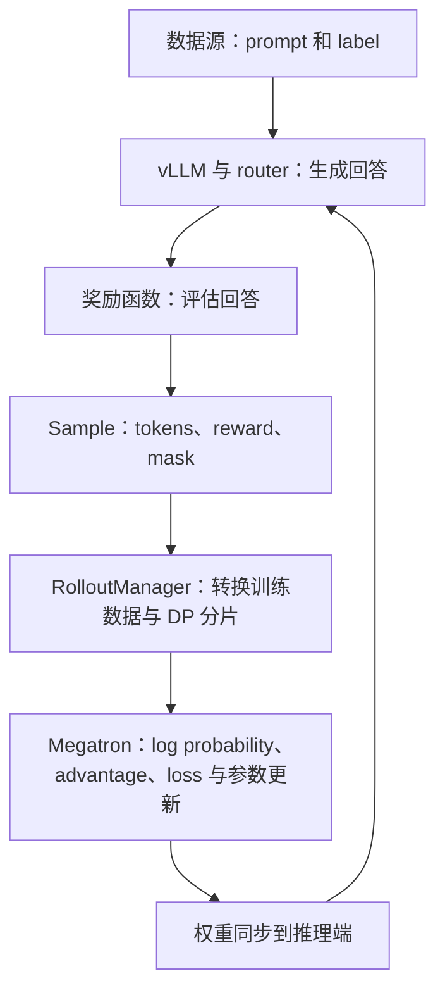

# 项目地图与核心概念

## 项目解决什么问题

Vime 是由 slime 衍生的大模型后训练框架，连接 Megatron 训练端与 vLLM 推理端。它既组织模型训练，也允许用户自定义生成、工具交互和奖励流程。Ray 负责跨进程的资源分配和任务调度。

先理解三个角色：训练模型更新参数；推理引擎使用参数生成回答；数据源与 rollout 编排把任务转成训练样本。不要把“生成一次回答”“执行一次 optimizer step”和“同步一次权重”当作同一件事。

## 一轮同步训练

这是概念图。实际代码包含过滤、样本分组、评估、显存卸载和 checkpoint 分支；是否计算 reference log probability、是否使用 critic，取决于配置。

## 目录分工

| 路径 | 职责 | 第一轮阅读范围 |
| --- | --- | --- |
| [train.py](../train.py) | 同步训练总流程 | 完整阅读 `train` |
| [train_async.py](../train_async.py) | 将下一轮生成与当前训练重叠 | 主循环与同步边界 |
| [vime/ray](../vime/ray/) | Ray worker、资源和 rollout 编排 | placement_group、rollout、actor_group |
| [vime/rollout](../vime/rollout/) | 数据源、生成、奖励和过滤 | data_source、vllm_rollout、rm_hub |
| [vime/backends/megatron_utils](../vime/backends/megatron_utils/) | 模型执行、损失、checkpoint、权重同步 | actor、model、loss |
| [vime/backends/vllm_utils](../vime/backends/vllm_utils/) | 推理引擎的部署与控制 | 初期只看参数，部署阶段深入 |
| [vime/utils](../vime/utils/) | 参数、类型与算法工具 | arguments、types、ppo_utils |
| [vime/observability](../vime/observability/) | 指标、日志、trace 与调试数据 | 根据实验需要查阅 |
| [vime/agent](../vime/agent/) | agent 轨迹、协议适配和沙盒抽象 | 主闭环熟悉后再读 |
| [vime_plugins](../vime_plugins/) | 模型与 rollout buffer 扩展 | 按需求选择 |
| [scripts](../scripts/) / [examples](../examples/) | 启动配置和工作流示例 | 先研究 Qwen3-4B 启动脚本 |
| [tests](../tests/) | 数据契约、算法与端到端验证 | 先看 Sample 与奖励 CPU 测试 |

## 必须认识的术语

| 术语 | 在项目里如何理解 | 核对位置 |
| --- | --- | --- |
| rollout | 用推理模型生成训练经验的过程 | [vllm_rollout.py](../vime/rollout/vllm_rollout.py) |
| actor / policy | 被优化的生成策略 | [actor.py](../vime/backends/megatron_utils/actor.py) |
| reference | 用于比较的参考策略；是否使用由配置决定 | actor 的 `train_actor` |
| critic / value | 估计价值的模型；部分算法配置使用 | actor 的 `train_critic` |
| reward | 对样本的评分，可能是标量或字典 | [rm_hub](../vime/rollout/rm_hub/__init__.py) |
| advantage | 用于策略更新的相对评价信号 | loss 的 `compute_advantages_and_returns` |
| log probability | 模型对实际生成 token 的对数概率 | loss 的 `get_log_probs_and_entropy` |
| loss mask | 指定 response 中哪些 token 参与损失 | RolloutManager 的数据转换 |
| DP / TP / PP / CP | 数据、张量、流水线、上下文并行 | [Megatron 配置](../docs/zh/advanced/megatron-config.md) |
| offload / colocate | 显存卸载 / 训练推理共享 GPU 资源 | train 主循环与 placement_group |

注意两种 `rollout_id`：主循环中的编号标识一轮调度；`Sample.rollout_id` 用于识别生成执行及其拆分样本。不要直接假设二者相同。自定义生成返回多个 sibling samples 时，它们需设置相同的 `Sample.rollout_id`，避免损失聚合重复计数。
